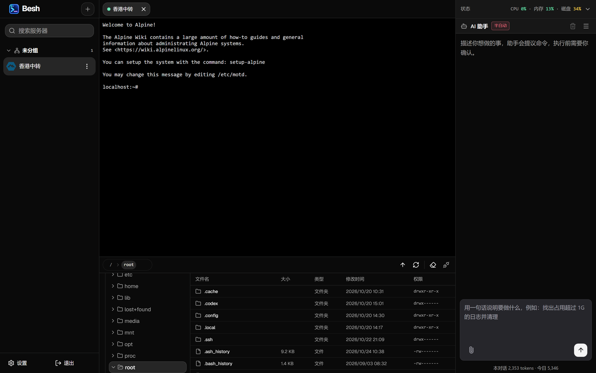

# Besh

浏览器里的 SSH 控制台，整个跑在 Cloudflare Workers 上——没有自己的服务器要维护，也没有本地数据库要备份。终端、SFTP、负载指标和一个"提议命令、由你批准"的 AI 助手在同一个界面里。

基于 Cloudflare Workers + Durable Objects + D1 + R2 构建，SSH 协议由仓库内的 `packages/ssh-core` 实现，不依赖 ssh2 之类需要原生绑定的库。

界面是 React 19 + Vite + Tailwind CSS 4，组件基于 shadcn/ui（Radix UI），终端用 xterm.js，浏览器内编辑器用 CodeMirror 6，多语言走 i18next。没有独立的 Web 服务：前端产物由 Worker 的静态资源绑定同源托管，页面、API、WebSocket 同一个域名。



## 来源

终端与 SFTP 的 SSH 协议实现提取自 [CF-Workers-WebSSH](https://github.com/cmliu/CF-Workers-WebSSH)（Apache-2.0）提供的 SSH 源码，包含报文编解码、密钥交换、加解密、认证交互与 SFTP 报文处理。连接状态机、双向 rekey、SFTP 会话层、主机指纹校验与界面适配由本项目实现。

## 功能

**终端**

- 完整 PTY/shell，断线后自动重连并保留已有输出（退避 0.5 / 1 / 2 / 4 / 8 秒，手动断开则不再重连）
- 会话中途 rekey：服务器发起的密钥交换与客户端按阈值（默认 1 GiB / 1 小时）主动发起的走同一条路径
- keepalive：每 45 秒发送一次 `keepalive@openssh.com`

**SFTP**

- 面包屑路径栏，点父级即跳转
- 右键菜单只列出当前可用的操作：新建文件 / 新建目录 / 重命名 / 下载 / 上传 / 复制路径 / 删除 / 返回上一级
- 文本预览、一次选择多个文件上传
- 传输队列：上传与下载排成一队逐个进行，列表显示每个文件的进度，可以单独取消或重试；中途断掉的块按已确认的字节续传，不会从头再来
- 浏览器内编辑文本文件：按扩展名语法高亮（sh / json / yaml / toml / ini / nginx / Dockerfile），Ctrl+S 保存，保存前比对大小与修改时间，发现外部改动可选择覆盖或重新加载；超过 512 KB 或二进制内容拒绝编辑
- 递归删除对每个子项重新 LSTAT，符号链接只删链接本身，不会跟到目标目录里删东西

**状态**

- CPU / 内存 / 磁盘百分比与用量，连接后立即采集、每 15 秒刷新
- 读不到核数时只显示三元组，不编造百分比

**AI 助手**

- 流式输出，生成过程中可以中断
- 模型只产出命令文本，风险判定与审批在服务端：提案 60 秒过期、单次使用，批准时重新读权限并复核命令文本
- 半自动模式：只读命令直接执行，其余仍要人工批准
- 附件支持 PNG /JPG/ JPEG / WebP，单张 8 MB，存在 R2；重新打开对话时最近 4 张图会重新挂进上下文
- token 用量按对话与按天记账（"今日"按 UTC 零点重置），仅做展示
- 任何 OpenAI 兼容、支持 function calling 的端点都能接

**安全与界面**

- 单管理员：PBKDF2-SHA-256 口令、会话令牌只存摘要、HttpOnly Cookie；改密与注销立即撤销已建立的 WebSocket
- 凭据用 AES-256-GCM 密封后存 D1，界面从不回显；主机指纹持久化，变更时拒绝连接
- 连接目标先校验再拨号：私网、回环、链路本地、云元数据地址、IPv6 映射写法与 DNS 重绑定都被拒绝
- 可选 Turnstile 人机验证--备注：强烈建议开启
- 三栏界面、深浅色主题、中英双语

## 系统要求

- Node.js ≥ 22.12
- 一个 Cloudflare 账号（Workers、D1、R2）

## 本地运行

```bash
npm ci
npm run check:web      # 构建前端，worker 直接托管 dist
npx wrangler d1 migrations apply besh --local
npm run dev
```

打开终端输出的地址，首次访问会显示创建管理员的表单。

`npm run check` 依次跑严格类型检查、前端构建和打包 dry-run。

## 部署到自己的 Cloudflare 账号

```bash
npm ci
npm run check:web
npx wrangler d1 create besh                     # 把返回的 id 填进 wrangler.toml
npx wrangler d1 migrations apply besh --remote
npx wrangler r2 bucket create besh
npx wrangler secret put CREDENTIAL_KEY          # base64 编码的 32 字节密钥
npx wrangler secret put TICKET_SECRET
npx wrangler deploy
```

首次访问会显示创建管理员的表单；建好之后这个入口自动关闭。Turnstile 是可选的，在设置里填 site key 与 secret 即可开启。

### 用 GitHub 部署（Workers Builds）

Fork 之后可以让 Cloudflare 直接跟着仓库构建，不用在本地跑命令：

1. `npx wrangler d1 create besh`，把返回的 `database_id` 写进你 fork 里的 `wrangler.toml`
2. `npx wrangler r2 bucket create besh`（或在 Cloudflare 面板里建）
3. 面板 → Workers & Pages → Create → 连接这个仓库，构建命令与部署命令填：

   ```
   npm ci && npm run check:web
   npx wrangler d1 migrations apply besh --remote --yes && npx wrangler deploy
   ```

4. 部署完成后，在 Worker 的 Settings → Variables and Secrets 里添加 `CREDENTIAL_KEY` 与 `TICKET_SECRET`（`wrangler deploy` 不会覆盖已有的 secret）

`database_id` 是 D1 实例的标识，不能用别人的；`name`、`database_name`、`bucket_name` 如果和账号里已有的重名，改成本项目里出现的那三处即可。

如果构建环境报权限错误，在 Settings → Build → Variables and secrets 里补 `CLOUDFLARE_API_TOKEN`（模板选 Edit Cloudflare Workers）与 `CLOUDFLARE_ACCOUNT_ID`。Node 版本低于 22.12 时构建会失败，同样在那里加 `NODE_VERSION=22`。

## 配置

`wrangler.toml` 里的绑定：

| 绑定 | 类型 | 说明 |
| --- | --- | --- |
| `DB` | D1 | 账号、服务器、分组、设置、对话与用量 |
| `ATTACHMENTS` | R2 | AI 附件原始字节，D1 只存 id、文件名与 MIME 类型 |
| `SESSIONS` | Durable Object | 每条 SSH 会话一个实例，持有 PTY 与 WebSocket 桥接 |
| `ASSETS` | 静态资源 | 构建好的前端，与 API 同源 |

需要设置的密钥：

| 变量 | 说明 |
| --- | --- |
| `CREDENTIAL_KEY` | 32 字节 AES-256 密钥的 base64。轮换后已存的服务器凭据全部无法解密，要么重填，要么换回旧密钥 |
| `TICKET_SECRET` | 会话票据的签名密钥 |

`[triggers]` 里有一个每天 04:17 UTC 的定时任务，清理没有任何对话指向的附件；只处理超过 24 小时的对象，正在上传的不受影响。

## 项目结构

```text
apps/worker/          Cloudflare 平台适配：HTTP 路由、Durable Object、Socket
apps/web/             Vite + React + shadcn/ui 界面，由 worker 的 assets 绑定托管
packages/contracts/   公开协议与错误码，worker 与前端共用
packages/ssh-core/    SSH 协议本身：传输、密钥交换、认证、通道、SFTP v3
db/migrations/        D1 表结构
assets/               README 截图
```

`ssh-core` 不引用任何平台 API（浏览器、Node、`cloudflare:sockets`），连接状态机、握手、通道与 SFTP 都能脱离 Worker 单独运行。

## 许可证

Apache-2.0，见 [LICENSE](LICENSE)。

`packages/ssh-core` 中的 SSH 传输、密钥交换、加解密与 SFTP 报文处理提取自同样以 Apache-2.0 发布的 CF-Workers-WebSSH（见上文"来源"一节），许可证兼容；该来源与本地修改也在 `LICENSE` 末尾的第三方声明里注明。
